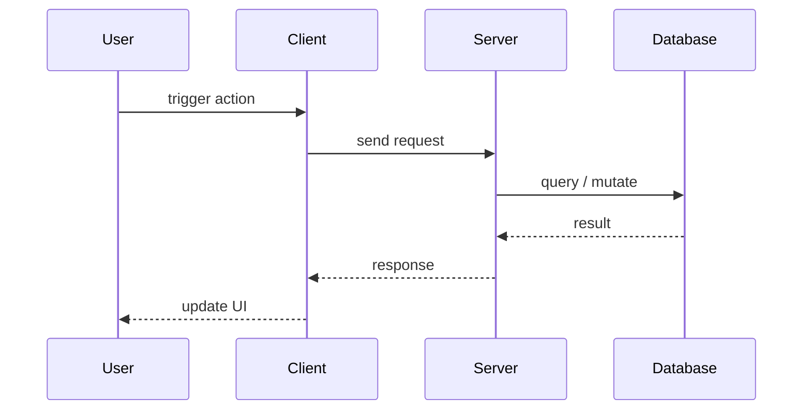

# Plagiarism_Detected

A two-feature web app that detects plagiarism in documents and predicts whether
a document is **human-written**, **AI-generated**, or **plagiarised**.

## Architecture / How it Works




> Built with FastAPI + React + scikit-learn + sentence-transformers.

## Features

### 1. Plagiarism Detection (4 algorithms)
Drop a document and pick an algorithm; we return which parts match a reference
corpus and how strongly.

| Algorithm | What it catches |
| --- | --- |
| **N-gram shingling + Jaccard** | Exact and near-exact copies (word-level) |
| **TF-IDF + Cosine** | Paraphrased / partial matches (n-gram aware) |
| **Sentence-Transformer Embeddings + Cosine** | Semantic similarity, paraphrases |
| **Winnowing (MOSS-style)** | Document fingerprinting — fast on large texts |

### 2. Authenticity Prediction (3-class)
Upload any document, get back a probability distribution over
`{human, ai, plagiarised}`. Built on perplexity + burstiness + vocabulary
features fed into a logistic-regression classifier.

## Quick start

```bash
# 1. Backend
cd backend
uv sync                                  # install Python deps
cp .env.example .env                     # optional, defaults work
uv run uvicorn app.main:app --reload     # API on :8000

# 2. Frontend (separate terminal)
cd frontend
npm install
npm run dev                              # Web on :5173
```

Open <http://localhost:5173>, drop a document, pick an algorithm.

## Docker

```bash
docker compose -f deploy/docker-compose.dev.yml up --build
```

## Development

```bash
make test        # pytest
make lint        # ruff + mypy
make verify      # full 6-phase verification
```

## Security

See [SECURITY.md](./SECURITY.md). Report issues via GitHub Security Advisories.

## License

MIT — see [LICENSE](./LICENSE).
